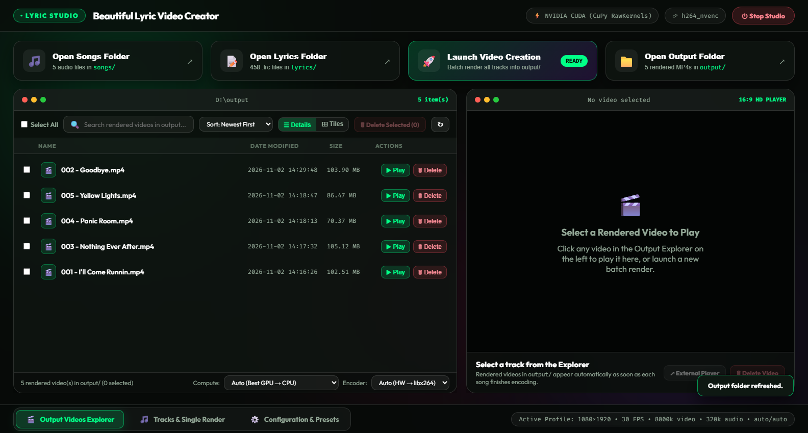
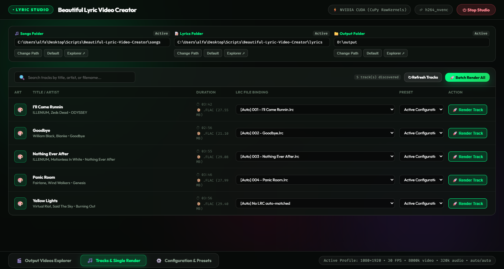
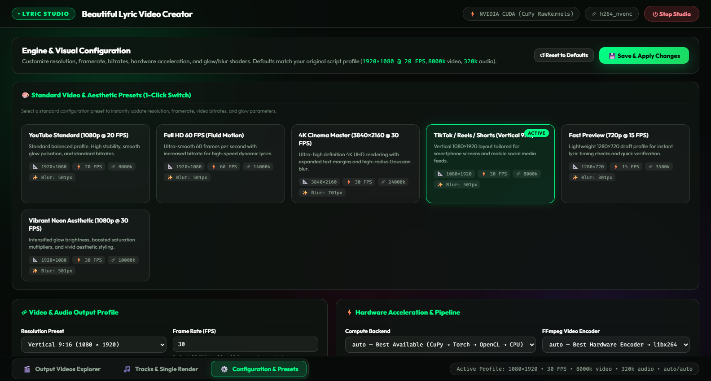
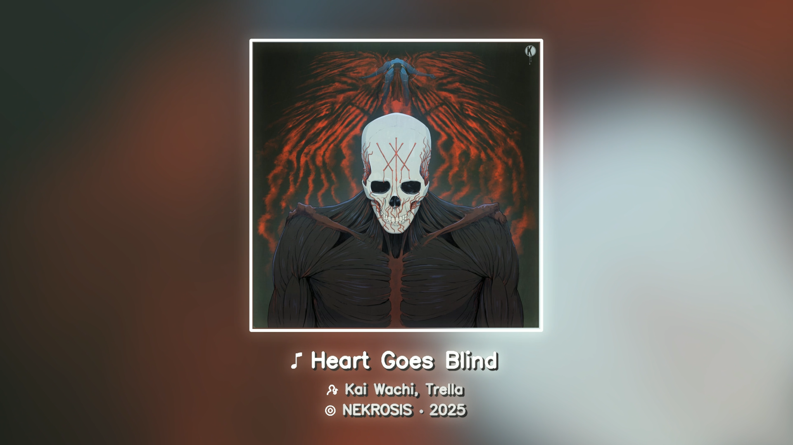
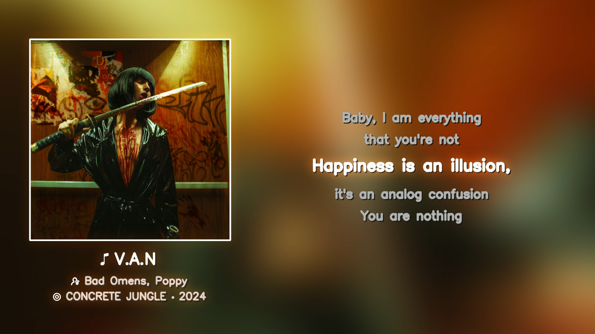

# Beautiful Lyric Video Creator

A high-performance, modular tool to automatically generate aesthetic music videos with synchronized lyrics. It supports multi-tier GPU acceleration (**NVIDIA CUDA via CuPy**, **AMD ROCm / Apple Metal MPS / Intel XPU / CUDA via PyTorch**, and **Cross-Vendor OpenCL via OpenCV `UMat`**) with a full **Vectorized CPU Fallback** and automatic **FFmpeg Hardware Encoder Detection**.

## Key Features

- **Multi-Backend Hardware Acceleration & CPU Fallback**:
  1. **CuPy (`cupy`)**: Custom CUDA C++ kernels (`sample_background`, `blend_roi_alpha`, `blend_roi_add`) + pinned host DMA buffers for maximum throughput on NVIDIA GPUs.
  2. **PyTorch (`torch`)**: Hardware-accelerated GPU tensor pipeline supporting **NVIDIA CUDA**, **AMD ROCm**, **Apple Silicon (`mps`)**, and **Intel (`xpu`)** GPUs.
  3. **OpenCL (`opencl`)**: Cross-vendor GPU acceleration via OpenCV's Transparent API (`cv2.UMat`) for **AMD Radeon**, **Intel Iris/Arc**, and **NVIDIA** GPUs without requiring CuPy or PyTorch.
  4. **Vectorized CPU (`cpu`)**: Multi-threaded OpenCV C++ SIMD (`cv2.warpAffine`) and fixed-point NumPy ROI blending for systems without a dedicated GPU.
- **Smart FFmpeg Encoder Probing**: Automatically probes and selects the fastest working H.264 encoder (`h264_nvenc` $\rightarrow$ `h264_amf` $\rightarrow$ `h264_qsv` $\rightarrow$ `h264_videotoolbox` $\rightarrow$ `h264_vaapi` $\rightarrow$ `libx264` CPU fallback).
- **Interactive Web Studio UI**:
  - **Output Video Explorer & Built-in Player**: Browse, search, filter, and stream rendered `.mp4` videos directly in your browser or launch external OS media players.
  - **Tracks & Single-Track Studio**: Inspect discovered audio files with duration/size/metadata, bind companion `.lrc` lyrics (auto-detected, custom, or Cover-Only mode), and render individual tracks without waiting for batch runs.
  - **1-Click Standard Presets**: Switch instantly between calibrated configurations (**YouTube 1080p Standard**, **Full HD 60 FPS Fluid**, **4K Cinema Master**, **TikTok/Reels 9:16 Vertical**, **Fast Draft Preview 720p**, and **Vibrant Neon Glow**).
  - **Workspace & Dynamic Folder Selection**: Switch seamlessly between project defaults (`songs/`, `lyrics/`, `output/`) and custom audio directories.
- **ROI Sprite Optimization**: Pre-composites static layers once per track and crops dynamic lyric overlays and Gaussian glow maps to their tight Region-of-Interest (ROI) bounding boxes, reducing VRAM/RAM usage by **>90%**.
- **Multi-Format Audio Support**: Extracts metadata and cover art from `.flac`, `.mp3` (ID3 APIC), `.m4a` (`covr`), `.ogg` (`metadata_block_picture`), and `.wav` (plus sidecar `cover.jpg`/`cover.png` fallback).
- **Synchronized Lyrics**: Parses `.lrc` files, normalizes Unicode homoglyphs, and recursively splits long lyric lines at natural punctuation boundaries.

---

## Project Architecture

```text
Beautiful-Lyric-Video-Creator/
├── main.py                          # CLI entry point & backward-compatible facade
├── setup.bat                        # Automated virtualenv creation & dependency installer
├── run_ui.bat                       # Web Studio launcher & background daemon manager
├── lyric_video_creator/
│   ├── __init__.py                  # Public package exports
│   ├── config.py                    # Pydantic V2 validated configuration (RenderConfig)
│   ├── models.py                    # Immutable domain models (TrackMetadata, LyricSegment, ROISprite)
│   ├── utils.py                     # Unicode sanitization, title cleanup, and structured logging
│   ├── media.py                     # Multi-format metadata/artwork extraction & recursive LRC parser
│   ├── color.py                     # Monte Carlo + K-Means dominant color & HSV glow heuristics
│   ├── compositor.py                # Static layout pre-compositor & ROI lyric sprite generator
│   ├── encoder.py                   # FFmpeg hardware encoder probing & frame-safe async writer
│   ├── pipeline.py                  # VideoRenderer & batch execution orchestrator
│   ├── backends/
│   │   ├── __init__.py              # Automatic 4-tier hardware detection & fallback factory
│   │   ├── base.py                  # ComputeBackend ABC & shared ROI math helpers
│   │   ├── cupy_backend.py          # NVIDIA CUDA C++ RawKernels + pinned memory DMA
│   │   ├── torch_backend.py         # PyTorch GPU backend (CUDA / ROCm / MPS / XPU)
│   │   ├── opencl_backend.py        # OpenCV UMat OpenCL backend (AMD / Intel / NVIDIA)
│   │   └── cpu_backend.py           # Vectorized OpenCV C++ SIMD + NumPy CPU backend
│   └── server/
│       ├── __init__.py              # FastAPI Web Studio package exports
│       ├── app.py                   # FastAPI application, routers & centralized exception handlers
│       ├── models.py                # Pydantic V2 request/response schemas for the Web Studio API
│       ├── presets.py               # Standard resolution & aesthetic rendering profiles
│       ├── service.py               # Thread-safe Web Studio service & render orchestrator
│       └── static/                  # Glassmorphism Single-Page Application (HTML5/CSS3/Vanilla JS)
└── tests/
    └── test_pipeline.py             # Automated unit & integration test suite across all backends
```

---

## Prerequisites

### 1. FFmpeg Installation (Mandatory)

FFmpeg and FFprobe are required for audio analysis and video encoding.

1. **Download**: Visit the [FFmpeg builds page](https://gyan.dev/ffmpeg/builds/) and download the release build (or install via `winget install Gyan.FFmpeg` / `apt install ffmpeg` / `brew install ffmpeg`).
2. **Verify**:
   ```bash
   ffmpeg -version
   ffprobe -version
   ```

### 2. GPU Acceleration (Optional — Automatic Fallback Included)

- **NVIDIA GPU (Fastest)**: Install the [NVIDIA CUDA Toolkit](https://developer.nvidia.com/cuda-toolkit-archive) and the matching CuPy wheel (`pip install cupy-cuda13x` or `pip install cupy-cuda12x`).
- **AMD / Apple Silicon / Intel GPU**: Install [PyTorch](https://pytorch.org/) for your platform, or rely on built-in **OpenCV OpenCL (`--backend opencl`)** which requires no extra Python packages.
- **CPU Only**: Works out of the box with zero GPU dependencies (`--backend cpu`).

---

## Quick Setup (Windows)

Double-click `setup.bat` or run:
```cmd
setup.bat
```
This automated script:
1. Detects Python 3.10+ (Python 3.13 recommended).
2. Scaffolds an isolated virtual environment in `.venv/`.
3. Upgrades `pip` and installs all dependencies from `requirements.txt`.
4. Verifies `ffmpeg` and `ffprobe` in system PATH.
5. Probes your hardware GPU accelerators (CUDA/PyTorch/OpenCL).

---

## Usage

### 1. Interactive Web Studio UI (Recommended)

Double-click `run_ui.bat` or run:
```cmd
run_ui.bat
```
*Note: `run_ui.bat` automatically launches the background daemon via `pythonw.exe`, opens your default web browser to `http://127.0.0.1:8686`, and **closes the launcher terminal immediately**. Use the **`⏻ Stop Studio`** button in the web page header to gracefully shut down the server at any time.*

#### Web Studio Tour

##### Tab 1: Output Videos Explorer & In-Browser Player
Browse rendered MP4s, stream them instantly, filter/search by title, view file sizes, or launch in your OS media player.


##### Tab 2: Tracks & Single-Track Studio
Inspect audio files with auto-detected metadata, bind companion `.lrc` lyrics (or toggle Cover-Only mode), pick a custom preset, and render individual tracks without waiting for full batch runs.


##### Tab 3: Configuration & Standard Presets Catalog
Apply 1-click profiles (**YouTube 1080p Standard**, **60 FPS Fluid Motion**, **4K Cinema Master**, **TikTok / Reels 9:16 Vertical**, **Fast Draft Preview 720p**, and **Vibrant Neon Aesthetic**) or fine-tune Gaussian blur kernels, bitrates, and glow parameters.


---

### 2. Batch CLI Mode

Process all audio files in the `songs/` folder using project defaults:
```bash
python main.py
```
*(Or inside the virtual environment: `.venv\Scripts\python.exe main.py`)*

---

### 3. CLI Advanced Flags & Real-World Recipes

#### CLI Options Reference

| Option | Type | Default | Description |
| :--- | :--- | :--- | :--- |
| `--music-dir <PATH>` | Path | `songs` | Directory containing input audio files (`.flac`, `.mp3`, `.m4a`, etc.) |
| `--lyrics-dir <PATH>` | Path | `lyrics` | Directory containing synchronized `.lrc` lyric files |
| `--output-dir <PATH>` | Path | `output` | Directory where rendered `.mp4` video files are written |
| `--width <INT>` | Int | `1920` | Output video width in pixels (must be even) |
| `--height <INT>` | Int | `1080` | Output video height in pixels (must be even) |
| `--fps <INT>` | Int | `20` | Video frame rate in frames per second |
| `--video-bitrate <STR>`| String | `8000k` | Target FFmpeg video bitrate (e.g., `8000k`, `14000k`, `24000k`) |
| `--audio-bitrate <STR>`| String | `320k` | Target FFmpeg audio bitrate (e.g., `192k`, `320k`) |
| `--backend <NAME>` | Choice | `auto` | Compute backend: `auto`, `cupy`, `torch`, `opencl`, `cpu` |
| `--encoder <NAME>` | Choice | `auto` | FFmpeg H.264 encoder: `auto`, `nvenc`, `amf`, `qsv`, `videotoolbox`, `vaapi`, `libx264` |
| `--debug` | Flag | `False` | Enable verbose diagnostic logging and live FFmpeg console output |
| `--ui` | Flag | `False` | Launch the interactive Web Studio server |
| `--port <INT>` | Int | `8686` | Web Studio HTTP port (default: `8686`) |
| `--foreground` | Flag | `False` | Keep Web Studio attached to the current terminal window |

#### Real-World CLI Recipes

```bash
# 1. TikTok / Instagram Reels / YouTube Shorts (Vertical 9:16 @ 30 FPS)
python main.py --width 1080 --height 1920 --fps 30 --video-bitrate 8000k

# 2. 4K Cinema Master (3840x2160 UHD @ 30 FPS with high-bitrate encoding)
python main.py --width 3840 --height 2160 --fps 30 --video-bitrate 24000k

# 3. Ultra-Fluid 60 FPS 1080p Video
python main.py --width 1920 --height 1080 --fps 60 --video-bitrate 14000k

# 4. Fast Draft Preview (720p @ 15 FPS for instant timing and synchronization checks)
python main.py --width 1280 --height 720 --fps 15 --video-bitrate 3500k

# 5. Custom Storage Paths (External Hard Drive or Network Share)
python main.py --music-dir "D:\LosslessFLACs" --lyrics-dir "D:\SyncedLRCs" --output-dir "D:\RenderedVideos"

# 6. Force Dedicated Hardware Backends
# NVIDIA RTX CUDA RawKernels + NVENC:
python main.py --backend cupy --encoder nvenc

# Cross-Vendor OpenCL GPU (AMD Radeon / Intel Arc):
python main.py --backend opencl --encoder amf

# Pure CPU SIMD Fallback (no GPU required):
python main.py --backend cpu --encoder libx264
```

---

## Screenshots

### **Cover-Only Mode**


### **Lyrics Mode**


---

## Video Comparison

Here is a comparison between the original rendering pipeline and the enhanced GPU-accelerated engine. Full render on [this .mp4](gh).

### **Previous Version (v0.0)**


### **Current Version (v1.0+)**


---

## Related Projects

This project pairs with [Music-Metadata-Handler](https://github.com/albertnica/Music-Metadata-Handler) and [Automatic-Lyrics-Synchronizer](https://github.com/albertnica/Automatic-Lyrics-Synchronizer).
